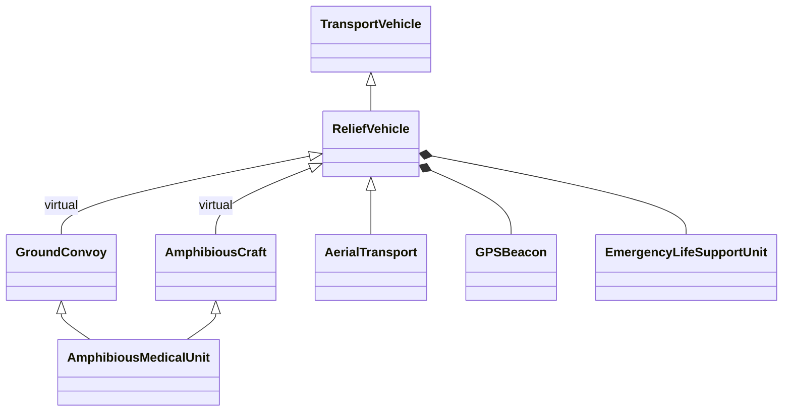

# Post-Earthquake Multi-Agency Emergency Relief Logistics Hub

**Course:** CIC-211 — Object-Oriented Programming  
**Institution:** Maharaja Agrasen Institute of Technology, Department of Computer Science and Engineering  
**Prepared for:** Rishabh Bansal  
**Language:** Standard C++17  
**Project option:** 2 (ERL-HUB)

## 1. Problem and objectives

After an earthquake, relief coordinators must allocate limited supplies while selecting transport appropriate to damaged infrastructure. A ground truck cannot cross a destroyed road, a helicopter requires safe weather, and a boat requires an open water corridor. Priority medical requests should precede routine deliveries. Departures must leave a reliable record of the agency, cargo, destination and fuel used.

ERL-HUB models these concerns in a console application. Its objectives are validated inventory operations, polymorphic route evaluation, medical priority dispatch, safe dynamic manifests and atomic persistence. It is a software simulation rather than a production emergency-response platform.

## 2. Modules and responsibilities

| Module | Responsibility |
|---|---|
| inventory.hpp / inventory.cpp | Validated cargo, owned dynamic manifests, depot ADT, allocation overloads, stream operators and tabular output |
| logistics.hpp / logistics.cpp | Exception hierarchy, vehicle hierarchy, diamond resolution, GPS/life-support composition, inline calculations and generic priority queue |
| hub.hpp / hub.cpp | Transaction coordinator, binary state store, audit restoration and fleet ownership |
| main.cpp | Validated line-based console input, inventory/fleet screens, mission creation, dispatch and demo |
| tests.cpp | Automated success and failure scenarios |

## 3. Class relationships

TransportVehicle encapsulates ID, payload limits, fuel and the live-instance count. ReliefVehicle introduces the abstract route interface and contained subsystems. Each concrete vehicle evaluates the same Route differently. The hybrid provides the final override and chooses a road if available, otherwise water. Both parents share exactly one ReliefVehicle virtual base, so identity, fuel and position are unambiguous.

ReliefHub owns vehicles using unique_ptr. Its base-pointer view is non-owning and must not be deleted by callers. A virtual destructor ensures derived objects are destroyed correctly. Manifest deliberately uses new[] and delete[] to demonstrate syllabus-required dynamic ownership; its deep copy and copy-and-swap assignment protect against aliasing and double deletion.

## 4. Allocation and prioritization

The volume overload allocates `min(stock units, floor(volume budget / unit volume))` units. The triage overload allocates one medicine kit per patient for priorities 1–3 and two per patient for priorities 4–5. These are explicit educational policy assumptions. Each allocation rejects nonpositive requests and duplicates. Vehicle mass and volume limits are checked before dispatch.

Mission urgency ranges from 1 to 5, with 5 highest. The UrgentMedicalFirst functor sorts descending priority and ascending mission ID. IncidentCommander may elevate a medical-capable vehicle's triage priority through friend access, but cannot bypass route, fuel, payload or stock checks. Changing a priority does not automatically change the already-created cargo request.

The queue uses a sorted vector for inspectable code: insertion costs O(n log n), top O(1) and removal O(n). For much larger deployments, a heap could improve push/pop performance. Depot SKU lookup is average O(1); deterministic inventory display costs O(s log s). Manifest duplicate checks are O(m), and order-independent identity comparison is O(m²), suitable for small manifests.

## 5. Dispatch algorithm

1. Validate agency and unique positive mission ID.
2. Resolve the selected vehicle and validate cargo weight/volume.
3. Evaluate the route through the virtual interface; reject blocked corridors and insufficient fuel.
4. Deep-copy the current inventory and audit state.
5. Deduct every cargo item in the copy. Any shortage discards the copy.
6. Append the full mission manifest, agency and computed fuel cost.
7. Write the staged state to a sibling temporary file; flush, close and verify it.
8. Atomically rename that file over the previous state on supported platforms.
9. Swap staged containers into memory, update vehicle fuel/position and increment dispatched tonnage using nonthrowing operations.

No vehicle, depot or audit mutation occurs before successful persistent commit. A process termination between rename and in-memory swaps is recovered by loading the newly committed state at restart.

## 6. Persistence format and recovery

| Field | Encoding |
|---|---|
| Magic/version | 8 bytes: ERLHUB01 |
| Payload length | 32-bit unsigned little endian |
| Checksum | 32-bit FNV-1a, little endian |
| Payload | Length-delimited serialized stock and audit records, floating values printed at 17-digit precision |

The payload is textual serialization within a binary framed file. This makes it portable across class layouts and easy to inspect while explicitly using binary fstream I/O. It is not an encrypted format. The checksum detects accidental corruption, not malicious modification.

A missing file creates an empty hub. Malformed headers, excessive lengths, truncation, checksums, duplicate mission IDs and inconsistent saved route costs cause startup failure rather than silently overwriting data. Committed records are replayed against the standard fleet to restore position and fuel. Pending queue entries are deliberately session-only.

Atomic replacement is supported by the target macOS/Linux filesystem semantics. The program does not claim power-failure durability without fsync, interprocess locking, network-filesystem guarantees or atomic replacement support on every operating system. Those are outside portable standard C++17. A failed rename preserves the old file. A stale temporary file is ignored during load and replaced on the next save.

## 7. Exception and input safety

All domain exceptions derive transitively from std::exception and own the diagnostic string returned by what(). The console catches errors and remains usable; startup corruption terminates with a nonzero exit status. Numeric prompts reject trailing input, nonfinite values are rejected at relevant domain boundaries, cargo quantities cannot be negative, and stock addition checks integer overflow. Stream extraction stages data so an invalid manifest does not partly modify its destination.

## 8. Validation and outcome

See TEST_REPORT.md for commands, observed results and the memory-check limitation. Tests exercise both ordinary operations and failure cases, especially preservation of disk and memory state after injected write failure. The demonstration proves that a high-priority medical mission is dispatched before a lower-priority ration mission and that the hybrid takes water when the road is blocked.

## 9. Boundaries and future work

The system assumes one hub process per file and synthetic, one-way fuel use. Missions complete immediately. It does not model travel time, return trips, crew shifts, real map graphs, medical diagnoses, authentication or real NDRF integration. A future version could add a graph-based routing engine, persistent pending queue, event-sourced restocking/refuelling, authenticated agency roles and a database with durable concurrent transactions. These features are not presented as implemented.
